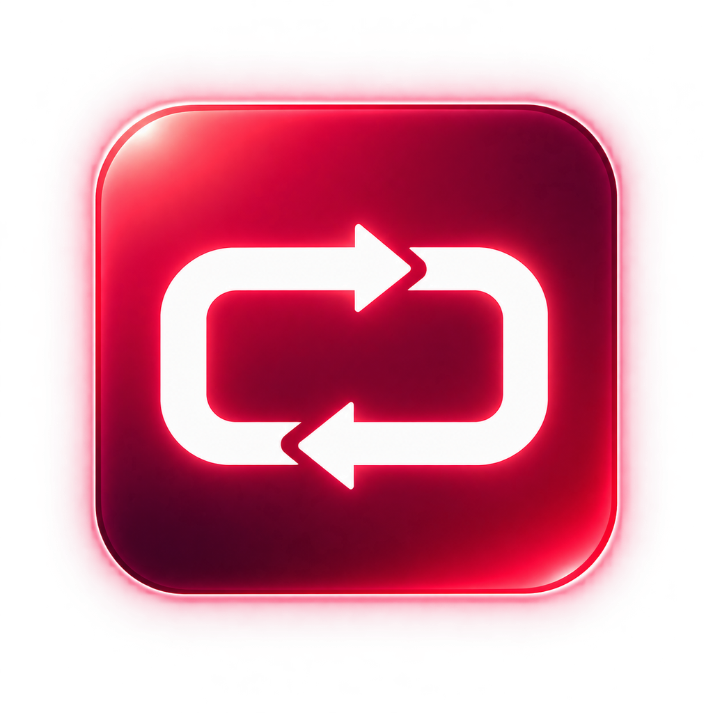

<p align="center">
  
</p>

# Local Remote Desktop

**English** | [简体中文](README.zh-CN.md)

## Background

This project started with an everyday office need: control a Mac from a Windows PC. After trying several tools, I still hadn't found a client that felt right. Some were awkward to use, others were dated, and some required payment. For a simple personal setup connecting my own two computers over the LAN, I wanted a lightweight, convenient tool without an additional cost.

With AI-assisted development, I decided to build a LAN remote desktop tool myself, starting with that everyday need and keeping connection and control as simple as possible.

## Introduction

Local Remote Desktop lets you view and control another computer's current desktop over your LAN. Devices connect directly, without an account or a cloud relay. When you return to the remote computer, your work is still in the same session.

The current connection direction is **Windows → Mac**. The longer-term goal is one application per platform that can connect to other devices or allow desktop control. Future plans include Windows ↔ Mac, mobile controllers, Linux and HarmonyOS.

## Features

- **Current-session control:** view the Mac screen and use your Windows keyboard and mouse.
- **Local, paired connections:** authentication and encryption, with pairing credentials stored securely on each device.
- **Remembered connections:** keep your target address and password for the next connection.
- **Desktop controls:** full screen, automatic reconnect and three picture-quality presets, adjustable while connected.
- **Convenient pairing:** generate a password or choose your own; existing keys remain valid until explicitly changed.
- **Text and file clipboard:** copy and paste plain text and regular files between paired devices, without pairing again for each transfer.

Short passwords and clipboard sharing are available in the preview; v0.1.0 uses the original keys and does not include clipboard sharing. Nearby-device selection and English/Chinese switching are available in current development builds. See the [user guide](docs/usage.md) for behavior and limits.

## Installation

The latest stable release is **v0.1.0**; the published preview is **v0.2.0-beta.1**. Windows downloads are available in [Releases](https://atomgit.com/zkxw2008/local-remote-desktop/releases). Mac currently requires a source build.

### Windows

Requires **Windows 10/11, x64**.

1. Download and extract the Windows ZIP.
2. Install [FFmpeg](https://ffmpeg.org/download.html) with H.264 decoding and make `ffmpeg.exe` available on PATH or beside the application. An existing working installation can be reused.
3. Run `LocalRemote.exe` from the preview package, or `RemoteMacLAN.exe` from v0.1.0. New source builds use `LocalRemoteDesktop.exe`.

Keep the extracted folder together. Release packages include the .NET Desktop Runtime.

### macOS

Requires **macOS 13+, Apple Silicon** and **Xcode Command Line Tools**. Install the tools with `xcode-select --install` if needed, then run:

```sh
git clone https://atomgit.com/zkxw2008/local-remote-desktop.git
cd local-remote-desktop
bash apps/macos/install-app.sh
```

The installer builds the current main branch and opens `/Applications/Local Remote Desktop.app`. Run it as your normal user, without `sudo`.

Allow **Screen Recording** and **Accessibility** in System Settings → Privacy & Security. Quit and reopen the app after granting access. The default installation resets this app's permission decisions; see the [Mac guide](docs/macos.md) for updates, signing and permission-preserving installation.

## Usage

1. On the Mac, open the app, start sharing and copy its pairing password.
2. On Windows, enter the Mac's LAN address in **Target IP** and enter the same password, then connect. Development builds also let you select a nearby Mac.
3. Click the remote picture to use your keyboard and mouse. Disconnect when finished; the Mac session stays open.

Both devices must be reachable on the same network, with TCP **47980** allowed to the Mac. Share the password only with devices you trust.

**F11** toggles full screen; **Ctrl+Alt+Esc** releases remote input. With Windows Shortcuts enabled, Ctrl+C/V maps to the Mac's Command+C/V. Clipboard sharing is enabled by default in supported paired sessions and can be changed in Settings → Clipboard. See the [file guide](docs/files.md) for supported copy-and-paste formats.

Currently, one controller and one display are supported. The Mac must be awake and logged in. Login-screen control and FileVault preboot unlock are unsupported; lock-screen control is not guaranteed.

## Development

The native applications use **Swift** on macOS and **C# / .NET 8 / WPF** on Windows. Mac capture and encoding use ScreenCaptureKit and VideoToolbox; the Windows viewer currently decodes through FFmpeg. Sessions use authenticated, encrypted TCP connections over the LAN. See the [architecture](docs/architecture.md) for details.

From the repository root, build Windows with the .NET 8 SDK:

```powershell
dotnet build apps/windows/LocalRemoteDesktop.csproj -c Release
dotnet run --project apps/windows/LocalRemoteDesktop.csproj -c Release
```

Build the Mac application on macOS:

```sh
bash apps/macos/build-app.sh
```

Main is **v0.3.0-alpha.1**, with a [Windows sharing preview](docs/windows-sharing.md). The Mac controller is the next milestone and is not implemented yet. Native Mac build and runtime acceptance remain pending; development changes do not replace existing release downloads. Check [validation status](docs/validation.md) and [Contributing](CONTRIBUTING.md) before preparing a release.

## Documentation

- [User guide](docs/usage.md) · [File clipboard](docs/files.md)
- [Mac installation and troubleshooting](docs/macos.md) · [Windows source build](apps/windows/BUILD.md)
- [Roadmap and version plan](docs/roadmap.md) · [Changelog](CHANGELOG.md)
- [Architecture](docs/architecture.md) · [Protocol](docs/protocol.md) · [Performance](docs/performance.md)
- [Cross-platform interface conventions](docs/interface.md) · [Project layout](docs/naming.md)
- [Validation status](docs/validation.md) · [Release process](docs/releasing.md)

## License

Local Remote Desktop is licensed under the [GNU General Public License v3.0 or later](LICENSE) (`GPL-3.0-or-later`). You may use, modify and redistribute it, including commercially. When distributing covered modified versions or binaries, follow GPL's corresponding-source and same-license requirements.

Third-party components retain their own licenses. See [NOTICE](NOTICE.md) for copyright, dependency and distribution information.
