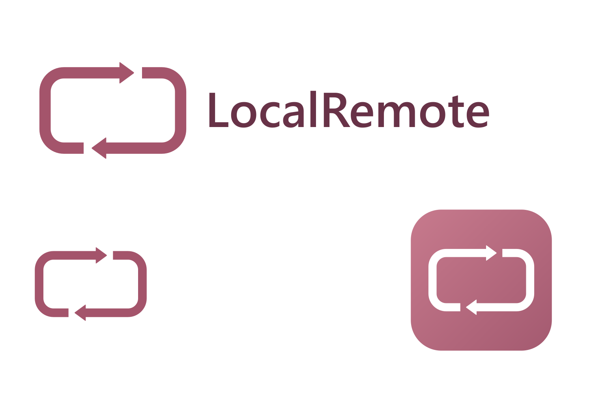

# LocalRemote 品牌图形

[English](README.md)

通用屏幕轮廓与两个反向箭头代表设备之间的双向桌面控制。屏幕标识采用干净的纯色，应用图标背景保留轻微车厘子红渐变；不含发光、浮雕、阴影或磨砂颗粒纹理。



## 文件

- `icon.svg`：可编辑的应用图标矢量母版，包含透明边距。
- `symbol.svg`：浅色背景使用的纯色标识，与母版共用几何形状。
- `icon-master.png`：母版导出的 2048px RGBA 图像。
- `icon.png`：应用顶部及首页使用的 1024px 图标。
- `LocalRemote.ico`、`LocalRemote.icns`：Windows 和 macOS 图标。
- `identity-board.png`：标识、文字及应用图标展示。

背景从 **#C77A8D** 渐变到 **#A45A70**，在柔和车厘子红基础上提亮。纯色标识与界面操作采用 **#A4546B**，文字采用 **#683247**。这是用户提供车漆色块的屏幕近似表达，并非官方车漆色号。

使用内置 image_gen 探索设计后，重新绘制为可编辑 SVG；目前以 SVG 为正式制作源，生成的探索图只作为参考。此前的发光版本已被替代。

## 重新导出

安装 Node.js、sharp、Python 和 Pillow，在仓库根目录执行：

```sh
npm install --no-save --package-lock=false sharp
node scripts/render-brand.mjs
python scripts/generate-icons.py
```

sharp 负责矢量渲染，Pillow 负责尺寸和格式转换。保留透明边距；屏幕、箭头及背景不含嵌入位图或视觉滤镜。展示板文字使用本机 Segoe UI/Arial 字体；应用图标不含文字，不依赖字体。

两端顶部使用导出的 PNG。Windows 嵌入 PNG/ICO，全屏时隐藏整个工具栏。Mac 打包 PNG/ICNS，并在启动时主动设置程序坞图标，覆盖登录代理直接启动。

当前功能仍为 Windows → Mac；双向控制和移动端属于规划。
